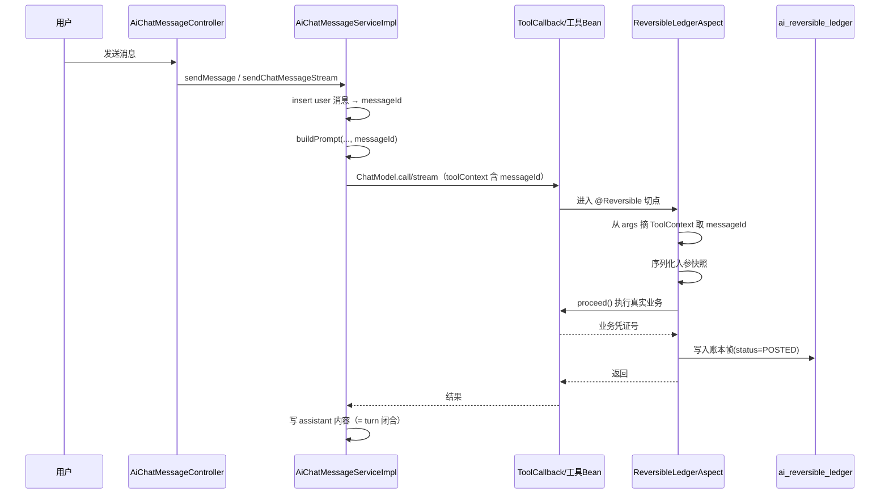
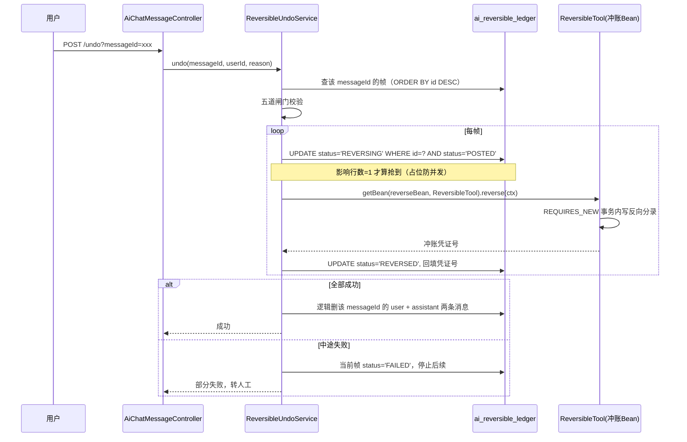

# 15 - 可撤回 Agent 操作（冲账式）实施方案

> 源设计：《基于冲账函数的可撤回 Agent 操作 · 设计文档（统一版）》
> 本文是该设计在 **yudao-cloud（JDK25 / Spring Boot 4.x / Spring Cloud 2025）本项目**内的最小落地版本。
> 基准代码：`d:\yudao\yudao-cloud-master-jdk25`，`master-jdk25` 分支。

---

## 一、结论与取舍

### 1.1 一句话方案

**撤回单元 = `ai_chat_message` 里 `type='user'` 那一行（用其 `id` 作为 messageId）；账本只新增 1 张 `ai_reversible_ledger`；正函数用 `@Reversible` 注解声明；冲账函数通过统一接口调用。其余能力（多租户隔离、上下文移除、消息归属校验）全部复用本项目已有机制，不新增代码。**

### 1.2 本项目形态判断（决定了方案落在哪一侧）

| 通道 | 实现 | 性质 |
|---|---|---|
| **Java `yudao-module-ai`** | `AiChatMessageController` → `AiChatMessageServiceImpl` → Spring AI `ChatModel` + `ToolCallbackResolver` | **主链路**。有会话、角色、工具注册、多租户、RBAC，工具真正产生业务副作用 |
| Python `yudao-module-agent` | `core/tool/api_tools.py` 的 `@tool` 函数 | **转发器**。经 httpx 调外部微服务，本身不写业务库；记忆在 LangGraph checkpointer |

**结论：撤回机制只落在 Java 侧。** Python 通道一期不接入（接法见 §12.3）。

### 1.3 砍掉的东西

源文档共 12 张表、3 个切面、4 个阶段。本项目按最小化原则处理：

| 源文档要求 | 本项目处理 | 依据 |
|---|---|---|
| 独立 `turn_registry` 表管理消息生命周期 | **砍掉** | `ai_chat_message` 已有 `reply_id` 自关联，user 行 `id` 天然是撤回单元（`AiChatMessageDO.replyId`） |
| `tenant` / `tenant_quota` / `tenant_sequence` 表 | **砍掉** | 租户主数据已有；撤回窗口用配置项；`id` 自增即租户内单调，LIFO 靠 `ORDER BY id DESC` |
| 反射兜底调用冲账函数 | **砍掉** | `getBean(name, 接口.class)` 必然返回代理，反射反而在 JDK 代理下失效 |
| `reversible_ledger_archive` + 冷热分离 | **砍掉** | 单表在数据量到达前不需要 |
| `idempotent_record` 表 | **砍掉** | 冲账幂等靠状态 CAS；正向幂等 MVP 不做（Spring AI 不重试工具调用） |
| `reversal_audit_log` 独立审计表 | **合并** | 撤回流水即账本上的反向行（`reversed_*` 字段） |
| 分表 / 独立 schema | **砍掉** | 规模未到达 |
| 跨服务冲账协调 | **砍掉** | 一期不涉及跨服务 |
| 三删（业务账 / 对话记忆 / 工具历史） | **保留，但其中两删是免费的** | 见 §7 |

**净新增：1 张表 + 5 个类 + 1 个 Controller 方法 + 3 处存量小改。**

---

## 二、概念映射

| 源文档概念 | 本项目落点 | 文件 |
|---|---|---|
| 租户边界 | `TenantBaseDO` + `TenantDatabaseInterceptor` 自动注入 `tenant_id` | `yudao-framework/yudao-spring-boot-starter-biz-tenant/.../core/db/` |
| 用户 / 会话 | `AiChatConversationDO.userId`、`AiChatMessageDO.userId` | `module-ai/dal/dataobject/chat/` |
| 消息（撤回单元） | `ai_chat_message` 中 `type='user'` 的行 | 同上 |
| turn 闭合 | assistant 行的 `content` 被写入（同步在 `sendMessage`，流式在 `doOnComplete`） | `AiChatMessageServiceImpl.java:176-179` / `:270-274` |
| 正函数 | `tool/function/*ToolFunction`（Bean 名 = `ai_tool.name`）或 `@Tool` 方法 | `module-ai/tool/function/`、`module-ai/tool/method/` |
| 正函数定位机制 | `ToolCallbackResolver.resolve(beanName)` ← 由角色 `toolIds` 决定 | `AiChatMessageServiceImpl.java:389-427` |
| 冲账函数 | 同工具类内的反向方法，实现 `ReversibleTool` | 新增 |
| 撤回入口 | `AiChatMessageController` 新增 `POST /ai/chat/message/undo` | 存量文件加方法 |
| 对话记忆 | `ai_chat_message` 逻辑删（`@TableLogic`） | 零代码 |
| 工具调用历史 | **Java 侧不落库** | 无需处理 |
| 上下文移除 | 逻辑删后 `selectListByConversationId` 自动过滤 | `AiChatMessageMapper.java:29-33` 用的是 `selectList(Wrapper)`，`@TableLogic` 生效 |

---

## 三、数据模型

### 3.1 DDL

```sql
CREATE TABLE `ai_reversible_ledger` (
  `id` bigint NOT NULL AUTO_INCREMENT COMMENT '账本帧编号',
  `conversation_id` bigint NOT NULL COMMENT '对话编号',
  `message_id` bigint NOT NULL COMMENT '用户消息编号（撤回单元）',
  `tool_name` varchar(128) NOT NULL COMMENT '正函数 Bean 名',
  `tool_input` json NULL COMMENT '入参快照',
  `biz_voucher` varchar(128) NULL COMMENT '业务凭证号',
  `reverse_bean` varchar(128) NOT NULL COMMENT '冲账函数 Bean 名',
  `status` tinyint NOT NULL DEFAULT 0 COMMENT '0=POSTED 10=REVERSING 20=REVERSED 30=FAILED',
  `window_minutes` int NULL DEFAULT NULL COMMENT '可撤回窗口（分钟），入账时固化',
  `reversed_voucher` varchar(128) NULL COMMENT '冲账凭证号',
  `reverse_reason` varchar(256) NULL COMMENT '撤回原因',
  `reversed_time` datetime NULL COMMENT '冲账时间',
  `creator` varchar(64) NULL DEFAULT '' COMMENT '创建者',
  `create_time` datetime NOT NULL DEFAULT CURRENT_TIMESTAMP COMMENT '创建时间',
  `updater` varchar(64) NULL DEFAULT '' COMMENT '更新者',
  `update_time` datetime NOT NULL DEFAULT CURRENT_TIMESTAMP ON UPDATE CURRENT_TIMESTAMP COMMENT '更新时间',
  `deleted` bit(1) NOT NULL DEFAULT b'0' COMMENT '是否删除',
  `tenant_id` bigint NOT NULL DEFAULT 0 COMMENT '租户编号',
  PRIMARY KEY (`id`),
  KEY `idx_tenant_msg` (`tenant_id`, `message_id`),
  KEY `idx_tenant_conv_status` (`tenant_id`, `conversation_id`, `status`, `message_id`)
) ENGINE = InnoDB COMMENT = '可撤回操作账本';
```

### 3.2 为什么不加 `seq`

源文档要求"租户内单调递增序列"。本项目不需要：同一 message 下的帧按 `id` 升序即执行顺序，逆序冲账直接 `ORDER BY id DESC`。`tenant_sequence` 表及其跨租户热点问题一并消失。

### 3.3 append-only 约束

账本帧一旦写入，**归属、入参、工具名永不修改**，只允许 `status` 迁移与 `reversed_*` 回填。

`deleted` 字段保留是为了符合芋道建表规范（`TenantBaseDO` 自带 `@TableLogic`），但**不提供任何删除入口**。

---

## 四、核心契约

包路径统一放 `cn.iocoder.yudao.module.ai.framework.reversible`，与 `framework/ai`、`framework/security` 同级（芋道「模块自带的框架层」惯例）。

### 4.1 `@Reversible` 注解

`framework/reversible/core/annotation/Reversible.java`

```java
@Retention(RetentionPolicy.RUNTIME)
@Target(ElementType.METHOD)
@Documented
public @interface Reversible {

    /** 冲账函数所在 Bean 名。留空 = 冲账函数与正函数在同一个 Bean（按类型反查，要求容器内唯一） */
    String reverseBean() default "";

    /** 可撤回窗口（分钟）。0 表示使用全局配置 yudao.ai.undo.window-minutes */
    int windowMinutes() default 0;

}
```

注解上没有「冲账方法名」——因为冲账统一走 `ReversibleTool.reverse()`，方法名恒定，写死在注解里没有意义（这是相对源文档的一处简化）。

**必须加在实现类的方法上，不能加在接口上**——Spring AOP 的 `@annotation` 切点不匹配接口注解，加了会静默失效。

### 4.2 `ReversibleContext`

`framework/reversible/core/context/ReversibleContext.java`

```java
@Data
public class ReversibleContext {

    private Long ledgerId;        // 账本帧编号
    private Long messageId;       // 撤回单元
    private String toolName;      // 正函数 Bean 名
    private String bizVoucher;    // 业务凭证号（冲账定位原分录的唯一必需字段）
    private String rawInput;      // 正函数入参 JSON
    private Long tenantId;        // 租户
    private Long operatorId;      // 撤回人
    private String reason;        // 撤回原因
    private LocalDateTime reversedAt;

    /** 冲账函数自行指定反序列化类型，框架不猜参数类型 */
    public <T> T input(Class<T> type) {
        return JsonUtils.parseObject(rawInput, type);
    }

}
```

`input(Class<T>)` 是必要的：`rawInput` 是 JSON，反序列化必须有目标类型。源文档只说"入参使用统一的冲账上下文对象"，没说类型由谁定——由冲账函数自己定最稳。

### 4.3 `ReversibleTool` 接口

`framework/reversible/core/ReversibleTool.java`

```java
public interface ReversibleTool {

    /** 执行冲账，返回冲账凭证号 */
    String reverse(ReversibleContext context);

}
```

**冲账函数必须实现此接口**。`UndoService` 用 `applicationContext.getBean(reverseBean, ReversibleTool.class)` 取，容器返回的必然是代理，事务与切面天然生效，且 JDK / CGLIB 两种代理都能取到方法。不要赌 `spring.aop.proxy-target-class` 的默认值。

### 4.4 `VoucherAware`（可选）

`framework/reversible/core/VoucherAware.java`

工具返回的 `Response` 实现此接口后，入账切面会把 `getBizVoucher()` 写入账本帧的 `biz_voucher`。

```java
public interface VoucherAware {
    String getBizVoucher();
}
```

不实现也可以——此时 `biz_voucher` 存 null，冲账函数只能自己从入参快照推导要冲哪一笔。但强烈建议实现：反向分录必须关联原凭证号，这是账本可审计的基础。

### 4.5 可撤回方法的编写规范

1. **`@Reversible` 优先标在业务方法上，而不是 AI 工具对接层**。
   工具层只做参数翻译 + 桥接（见 §8.1.1）。理由：同一业务操作有多个入口（AI / REST / 定时任务），
   标在工具层会让入账语义取决于调用入口。
   没有业务层的工具（直接在工具类里写 SQL / 调 HTTP）才退化为标工具方法。

2. **必须能拿到 `ToolContext`**（这条约束只针对「标在工具方法上」的写法）。
   两种合格形态：
   - `BiFunction<Request, ToolContext, Response>` —— 样板 `tool/function/UserProfileQueryToolFunction.java:28-30`
   - 「`@Tool(name = "...")` 方法 + ToolContext 参数」—— 样板 `tool/function/DbQueryToolFunction.java`

   单参 `Function<Request, Response>` **不合格**：messageId 靠 `ToolContext` 传递，单参工具拿不到（原因见 §5.1）。
   业务方法不受这条约束 —— 它从 `ReversibleContextHolder` 取上下文。

3. **不得吞异常**。不能用 `try-catch` 包住业务后返回"操作失败"字符串，否则失败会被当成成功入账。
   反例参考：`yudao-module-agent/core/tool/api_tools.py`（全量 try-except 返回字符串）。
4. **只读工具不加 `@Reversible`**（`directory_list`、`weather_query`、`user_profile_query` 均属此列，天然不进账本）。
5. 冲账方法 `implements ReversibleTool`，并显式用 `@Reversible(reverseBean = "...")` 指过来
   —— 因为冲账逻辑通常在业务层、与正函数不在同一个 Bean。

**两个注解位置约束**（两种写法都适用）：必须是 `public` 方法；必须标在实现类方法上，不能标接口方法上。

### 4.6 冲账函数写在哪一层

**结论：业务层。** 既不写框架层，也不写 AI 工具层。

#### 决定归属的三条性质

| 性质 | 推论 |
|---|---|
| **它运行在「撤回请求」线程，与 AI 调用链无关**。`ReversibleUndoServiceImpl.undo()` 由 REST 接口 `/ai/chat/message/undo` 触发（用户点撤回），此时既没有 `ToolContext`，`ReversibleContextHolder` 也是空的（桥接切面拦的是带 `ToolContext` 参数的方法，撤回接口没有） | 放 `tool/function/`（AI 适配层）是**逻辑错位**：名字叫 Tool，却跟工具调用链没有任何关系。它的数据来源只有 `ReversibleContext` 入参 |
| **它必须能访问数据层**（追加反向分录、读原单据、算反向值） | 放 `framework/reversible/`（框架层）会让框架反向依赖业务 Mapper —— 框架不该认识任何具体业务 |
| **它由正函数定义**（配对），且可能需要调**其他** Service / Mapper（联动库存、通知外部系统、释放占用） | 与正函数放**同一个业务包**，配对关系一眼可见，重构时不易漏改；跨模块调用也天然合法 |

> 一句话概括：**冲账是「被正函数定义的一次业务回退」，不是「一个 AI 工具」**。它借用了 `ReversibleTool` 这个接口，但那只是技术外壳。

#### 推荐形态：拆成「业务动作」+「技术薄壳」两层

**第一层 —— 业务动作**（真正的领域逻辑，放在正函数所在的 Service 里）：

```java
@Service
public class WmsReceiveService {

    @Resource private WmsReceiveMapper receiveMapper;
    @Resource private WmsReverseRecordMapper reverseRecordMapper;
    @Resource private WmsStockService stockService;          // ← 可以调其他 Service

    @Reversible(reverseBean = "wmsReceiveReversibleAdapter")
    public Long createReceive(WmsReceiveCreateReqDTO req) {   // 单个 DTO：多参会让冲账函数取不到原始入参
        // 正业务
    }

    /**
     * 冲账的业务动作 —— 一次真实的业务回退，不是技术动作
     *
     * 与正函数在同一个类，因此最清楚「反向」的领域含义；
     * 可以调 Mapper、可以联动其他领域服务。
     */
    public String reverseReceive(String receiveNo, String reason, Long operatorId) {
        WmsReceiveDO receive = receiveMapper.selectByNo(receiveNo);
        // 1. 追加反向分录（负数量），关联原凭证号
        WmsReverseRecordDO record = new WmsReverseRecordDO()
                .setSourceVoucher(receiveNo)                 // 必须关联原凭证号
                .setSkuId(receive.getSkuId())
                .setQty(-receive.getQty())
                .setReason(reason)
                .setOperatorId(operatorId);
        reverseRecordMapper.insert(record);
        // 2. 联动其他领域
        stockService.release(receive.getSkuId(), receive.getQty());
        return record.getReverseNo();
    }
}
```

**第二层 —— 技术薄壳**（只做 `ReversibleContext` ⇄ 业务参数 的翻译，无业务逻辑）：

```java
@Component("wmsReceiveReversibleAdapter")
public class WmsReceiveReversibleAdapter implements ReversibleTool {

    @Resource private WmsReceiveService wmsReceiveService;

    @Override
    public String reverse(ReversibleContext context) {
        return wmsReceiveService.reverseReceive(
                context.getBizVoucher(),     // 原凭证号：定位「要冲哪一笔」
                context.getReason(),
                context.getOperatorId());
    }
}
```

**为什么薄壳要独立成类**：一个类只能有一个 `reverse()`。若正函数所在 Service 有多个可撤方法
（`createReceive`、`cancelReceive`…），薄壳必须分开写，各指各的业务动作。

**包结构**（薄壳与正函数同包，配对关系一眼可见）：

```
service/wms/
  WmsReceiveService.java                  ← 正函数 + 冲账业务动作
  WmsReceiveReversibleAdapter.java        ← 薄壳
```

**形态选择**：

| 情况 | 怎么写 |
|---|---|
| Service 只有 1 个可撤方法，冲账逻辑简单 | 让 Service 直接 `implements ReversibleTool`，`@Reversible` 不写 `reverseBean`（**同 Bean 模式，最省事**） |
| Service 有多个可撤方法 | 每个配一个独立的 Adapter 类，用 `reverseBean` 指过去（**推荐**） |
| 冲账逻辑复杂、涉及多领域 | Adapter 只做翻译；业务动作可以进一步抽成领域服务 |

> ⚠️ **标在业务方法上，`reverseBean` 必须显式写。**
> 业务 Service 通常不实现 `ReversibleTool`（薄壳是独立的 Adapter），留空会让
> `resolveBeanName` 反查出业务 Service 的 Bean 名，而它并非 `ReversibleTool`。
>
> 这个配置错误原本会**拖到用户点撤回时才爆**：入账时毫无异常（`resolveBeanName` 只查 Bean 名不查类型），
> 撤回时 `getBean(name, ReversibleTool.class)` 抛 `BeanNotOfRequiredTypeException`，
> 而那一帧已被 CAS 改成 `REVERSING`、随后标 `FAILED` —— **永久不可再撤**。
>
> 已加 fail-fast 修掉：`ReversibleLedgerAspect.validateReverseBean(reverseBean, joinPoint)`
> 在**入账时**就校验 Bean 存在且 `isTypeMatch(.., ReversibleTool.class)`，有问题当场抛异常。

#### 六条硬性注意事项

1. **冲账函数内不要标 `@Reversible`** —— 撤回本身不该再入账。
2. **幂等不用自己做**：`casStatus` 保证同一帧只被冲一次（`POSTED → REVERSING` 抢不到就跳过）。
   但**冲账内部若有非事务性副作用**（调外部 HTTP、发 MQ），仍需自行考虑重复执行风险。
3. **冲账链路内部一律用默认事务传播（`REQUIRED`）**，**不要**用 `REQUIRES_NEW`。
   外层已经是 `TransactionTemplate(PROPAGATION_REQUIRES_NEW)` 每帧一个事务；内部再用 `REQUIRES_NEW`
   会挂起外层、另开事务，破坏「一帧 = 一个原子事务」的语义。
4. **不要依赖 `ReversibleContextHolder`**：撤回不经过 AI 链路，Holder 是空的。
   冲账所需的一切只能从 `ReversibleContext` 入参取（凭证号、原始入参快照、操作人、原因）。
5. **逆序冲账由框架保证**（`selectListByMessageId` 按 `id` 倒序），业务层不必操心顺序。
6. **正函数的业务参数应收敛为单个 DTO**。这是**功能约束**，不是风格建议：

   | 正函数签名 | 入参快照 `rawInput` | `ReversibleContext#input(Class)` |
   |---|---|---|
   | `createReceive(WmsReceiveCreateReqDTO req)` | `{"receiveNo":"RCV-001",...}` | ✅ 可用 |
   | `createReceive(String receiveNo, Long skuId, Integer qty)` | `["RCV-001",1001,5]` | ❌ 抛 Jackson `MismatchedInputException` |

   多参时冲账失败 → 帧标 `FAILED` → **永久不可再撤**。
   注意限制的是**正函数**的参数；**冲账函数自身**的参数不受影响（它从 `ReversibleContext` 取数据）。

   > 例外：冲账只靠凭证号定位、确实不需要原始入参时，多参也能跑通（`input()` 不会被调用）。
   > 但这属于"碰巧没事"，不建议依赖。

> 边际情况：如果将来把「撤回」本身也做成 AI 工具（用户说"帮我撤回刚才那步"），
> 那时 Holder 里会有值 —— 但那是**当前这条撤回消息**的 messageId，
> 不是被撤回消息的。冲账函数仍然只能从 `ReversibleContext` 取数据，不能读 Holder。

---

## 五、正向链路（入账）

### 5.1 messageId 如何抵达切面：走 ToolContext

**不能用 ThreadLocal。** `sendChatMessageStream` 里 `chatModel.stream(prompt)` 的工具调用执行在 Flux 线程上，项目代码自己已有佐证——`TenantUtils.executeIgnore` 的注释写着「Flux 异步无法透传租户」。

本项目已有现成的、经验证的下传通道：

```
AiChatMessageServiceImpl.sendMessage / sendChatMessageStream
  └─ createChatMessage(...) → userMessage.getId()          ← 这就是 messageId
  └─ buildPrompt(...)                                       ← 需加 messageId 参数
       └─ AiUtils.buildCommonToolContext()                  ← 需加 messageId 参数
            └─ ChatOptions.toolContext(toolContext)         ← 已有，:379
                 └─ Spring AI 自动注入 apply(request, toolContext)
                      └─ @Reversible 切面从 joinPoint.getArgs() 摘出 ToolContext
```

Spring AI 版本 **2.0.0**（`yudao-module-ai-server/pom.xml:22`）。

### 5.2 时序



### 5.3 切面职责与事务边界

| 项 | 做法 |
|---|---|
| 事务 | `TransactionTemplate.execute()` 把 `proceed()` + 写帧包在**同一事务** |
| 为什么不用 `@Transactional` | 切面与业务方法的注解要抢 order（默认 `LOWEST_PRECEDENCE`），顺序一错就变成"业务提交了、帧没写"。`TransactionTemplate` 零歧义 |
| 业务抛异常 | 帧不写入，整体回滚，工具调用对 LLM 表现为失败 |
| 拿不到 ToolContext / messageId | **抛异常，禁止静默跳过**。"以为可撤、实际无账本"是最危险的失败模式 |
| 快照内容 | 入参 JSON（`tool_input`）+ 业务返回的凭证号（`biz_voucher`） |

---

## 六、反向链路（撤回）

### 6.1 接口

```
POST /ai/chat/message/undo?messageId={messageId}&reason={可选}
```

归属校验照抄 `AiChatMessageController.deleteChatMessage`（`AiChatMessageController.java:114-120`）的写法。

### 6.2 五道闸门（顺序固定）

| 顺序 | 闸门 | 判定 | 失败 |
|---|---|---|---|
| 0 | 归一化 | 传的是 assistant 行 → 换成它的 `reply_id`；传 user 行 → 直接用 | — |
| 1 | 声明 | 该 messageId 下有账本帧；无帧则降级为"仅清记忆" | 提示无操作可撤 |
| 2 | 归属 | `message.userId == getLoginUserId()` 且租户一致 | 拒绝 + 审计告警 |
| 3 | 时间 | assistant 行 `content` 非空（已闭合）且 `update_time` 在窗口内 | 「操作进行中」/「已超过可撤回时间」 |
| 4 | 状态 | 该 messageId 下全部帧为 `POSTED` | 已撤过 / 部分失败 |
| 5 | **因果** | 该会话下不存在 `message_id` 更大的 `POSTED` 帧 | 「请先撤回更晚的消息」 |

**第 5 道是本项目相对源文档新增的。** 源文档默认"撤最近一条"，天然无因果问题；改为前端点选任意 messageId 后，若不校验，会出现"消息 A 建单、消息 B 基于 A 拣货，单撤 A 后 B 的帧成为孤儿"。

第 5 道把全局 LIFO 降级为**局部 LIFO**：既能点选，又不产生孤儿分录。实现是一条 `count`，命中 `idx_tenant_conv_status`。

### 6.3 执行时序



### 6.4 并发与失败

| 场景 | 处理 |
|---|---|
| 同一 messageId 并发撤回 | 靠 `UPDATE ... WHERE status='POSTED'` 的 CAS，影响行数为 0 直接跳过 |
| 多实例部署 | 同上，行锁天然安全，不需要分布式锁 |
| 中途冲账失败 | 立即停止，已冲的保留，未冲的不动，该 messageId 标记部分失败，**不自动重试剩余帧** |

---

## 七、记忆清理（三删的本项目形态）

| 源文档要求 | 本项目 | 成本 |
|---|---|---|
| 业务层：冲账 | `ReversibleUndoService` 调冲账函数 | 见 §6 |
| 记忆层：删该 turn 的对话消息 | `ai_chat_message` 逻辑删两条（user + assistant） | **零代码** |
| 工具历史层：删工具调用记录 | Java 侧根本没有工具调用落库表 | **零代码** |

**为什么逻辑删就等于从上下文消失**：`AiChatMessageServiceImpl` 构建 Prompt 时的历史消息来自 `chatMessageMapper.selectListByConversationId(...)`（`:147` / `:204`），而 `AiChatMessageMapper.selectListByConversationId` 用的是 `selectList(new LambdaQueryWrapperX<>())` —— MP 内置方法，`@TableLogic` 会自动追加 `deleted = 0`。撤回后这两条消息不再被查出，`filterContextMessages`（`:439`）自然不带它们进 Prompt。

**撤回指令本身不入对话历史**：Java 侧撤回是独立的 Controller 接口，不经过 `ChatModel`，天然满足"控制通道不污染推理上下文"。

**UX 取舍**：逻辑删后前端也看不到该消息（消息列表同样被过滤）。若产品上需要"灰显已撤回消息"，则不能在 `ai_chat_message` 上做逻辑删，需另加标记字段——这是本期唯一需要产品确认的点。

---

## 八、组件清单

### 8.1 新增

| # | 文件 | 说明 |
|---|---|---|
| 1 | `sql/mysql/ai-reversible-2026-09-17.sql` | `ai_reversible_ledger` 建表 |
| 2 | `framework/reversible/core/annotation/Reversible.java` | 注解 |
| 3 | `framework/reversible/core/context/ReversibleContext.java` | 冲账上下文 |
| 4 | `framework/reversible/core/ReversibleTool.java` | 冲账统一接口 |
| 5 | `framework/reversible/core/VoucherAware.java` | 凭证号回传接口（可选） |
| 6 | `framework/reversible/core/enums/ReversibleStatusEnum.java` | 状态枚举 |
| 7 | `framework/reversible/core/aop/ReversibleLedgerAspect.java` | 入账切面 |
| 8 | `dal/dataobject/reversible/ReversibleLedgerDO.java` | 继承 `TenantBaseDO` |
| 9 | `dal/mysql/reversible/ReversibleLedgerMapper.java` | 继承 `BaseMapperX` |
| 10 | `service/reversible/ReversibleUndoService.java` + `Impl` | 五道闸门 + 编排 |
| 11 | `framework/reversible/core/context/ReversibleContextHolder.java` | **上下文 Holder**（2026-09-18 新增） |
| 12 | `framework/reversible/core/aop/ReversibleBridgeAspect.java` | **桥接切面**（2026-09-18 新增） |

（2–6 可合并在同一次提交，7 单独，8–10 单独）

### 8.1.1 为什么后来加了「上下文 Holder + 桥接切面」

**触发原因**：初版让 `@Reversible` 只能标在 AI 工具方法上（因为 messageId 靠方法参数里的 `ToolContext` 传）。这是设计失当 ——

- 同一个业务操作会有多个入口：AI 工具、REST 接口、定时任务、其他 Service。
  标在工具层意味着**入账与否取决于调用入口**：「走 AI 就入账、走 REST 就不入账」，
  同一个业务操作两套语义，说不通。
- 可撤回的语义单元是**业务操作**，业务操作由业务方法定义，不该由 AI 工具定义。
- 冲账函数天然属于业务层（要写反向分录，需要 Repository / 事务 / 领域规则），工具层没有这些。

**改法**：加一层上下文桥，让注解能标到业务层。

```
AI 工具方法（持 ToolContext）
    → ReversibleBridgeAspect 把 messageId/conversationId/tenantId 写进 ReversibleContextHolder
    → 同线程调用业务方法（标了 @Reversible，签名零 AI 概念）
    → ReversibleLedgerAspect 从 Holder 读上下文，写账本帧
```

`ReversibleLedgerAspect.resolveContext()` 因此改成**两级来源**：

1. 方法参数里的 `ToolContext`（注解标在工具方法上，兼容旧写法，优先级更高）
2. `ReversibleContextHolder`（注解标在业务方法上）

**关键点：ThreadLocal 在这里是可靠的。** 写入点是「工具方法入口」—— 那里既拿得到 `ToolContext`、
又已经处于工具执行线程上；业务方法是被**同线程**的普通 Java 方法调用触发的。
此前「工具在 Flux 线程执行、TTL 不继承」的顾虑针对的是「请求线程 → 工具线程」这一跳，与本场景不同。

**非 AI 入口的行为**：REST / 定时任务调用带 `@Reversible` 的业务方法时，Holder 为空 →
切面**跳过入账**并直接执行业务（不抛异常）。这是正常路径：没有 AI 上下文 = 不是 Agent 操作 = 无需账本。

注意：**没有独立的「冲账切面」**。源文档要求冲账切面负责幂等 / 事务 / 审计，本项目里这三项分别由状态 CAS、`TransactionTemplate(REQUIRES_NEW)`、账本帧的 `reversed_*` 字段承担，因此不需要再写一个切面。

### 8.2 存量改动

| 文件 | 位置 | 改动 |
|---|---|---|
| `yudao-module-ai-api` `enums/ErrorCodeConstants.java` | 末尾 | 新增「可撤回操作 1-040-012-000」错误码段（7 个） |
| `util/AiUtils.java` | `:36` 附近 | 新增常量 `TOOL_CONTEXT_MESSAGE_ID`、`TOOL_CONTEXT_CONVERSATION_ID` |
| `util/AiUtils.java` | `:156` | `buildCommonToolContext()` 改为 `(Long messageId, Long conversationId)` 并写入 context |
| `service/chat/AiChatMessageServiceImpl.java` | `buildPrompt` 方法签名 | 增加 `Long messageId` 参数 |
| `service/chat/AiChatMessageServiceImpl.java` | `:172` | 调用处传入 `userMessage.getId()` |
| `service/chat/AiChatMessageServiceImpl.java` | `:229` | 同上（流式分支） |
| `service/chat/AiChatMessageServiceImpl.java` | `:379` | 改为 `buildCommonToolContext(messageId, conversation.getId())` |
| `controller/admin/chat/AiChatMessageController.java` | 注入区 + `deleteChatMessage` 前 | 注入 `ReversibleUndoService`，新增 `undo` 方法 |

**存量改动共 8 处，全部是加参数 / 加常量 / 加方法，没有改写任何既有逻辑。**

### 8.3 关于「可撤回工具本身」

上表不包含工具改造，因为**本项目现有工具没有一个是「写业务库」的**：

| 工具类 | 工具名 | 形态 | 能否撤回 |
|---|---|---|---|
| `DirectoryListToolFunction` | `directory_list` | 单参 `Function<Request, Response>` | 否：只读，且拿不到 ToolContext |
| `WeatherQueryToolFunction` | `weather_query` | 单参 `Function<Request, Response>` | 否：同上 |
| `UserProfileQueryToolFunction` | `user_profile_query` | `BiFunction<Request, ToolContext, Response>` | 形态合格，但是只读查询 |
| `DbQueryToolFunction` | `@Tool` 注解上的名字（Bean 名默认 `dbQueryToolFunction`） | 普通类 + `@Tool` 方法（含 ToolContext 参数） | 形态合格，但是只读查询（白名单 4 张表 SELECT） |
| `PersonServiceImpl` | `ps_create_person` / `ps_update_person` / `ps_delete_person` 等 | 普通类 + `@Tool` 方法（**无** ToolContext） | 否：写 `ConcurrentHashMap`，重启即失；且缺 ToolContext |

**两条结论**：

1. `@Reversible` 支持**两种**工具形态——`BiFunction<Request, ToolContext, Response>`，以及「`@Tool` 方法 + ToolContext 参数」。这两种形态在本项目里都有现成先例（`UserProfileQueryToolFunction` / `DbQueryToolFunction`）。
2. 工具名与 Bean 名**不一定相同**：`@Component("xxx")` 形态下二者一致，`@Tool(name = "yyy")` 形态下工具名是注解的值。切面因此按「`@Tool(name)` 优先、Bean 名兜底」解析（见 `ReversibleLedgerAspect.resolveToolName`），否则账本里的 `tool_name` 会和 `ai_tool` 表对不上。

框架落地后还需要**一个真正写入业务库的工具**做端到端样板：改造成上述任一形态，在方法上标 `@Reversible`，并实现配套的 `ReversibleTool.reverse()`。

---

## 九、实施步骤

### Step 1 — 先验证上下文透传（不写任何 AOP 代码）

给 `AiUtils.buildCommonToolContext` 加 `messageId` 并传入，在 `UserProfileQueryToolFunction.apply` 里打印读到的值。**同步接口 + 流式接口各跑一次。**

这一步过不了，后面全白做——因为流式那条路的上下文能否穿透 Flux 只有实跑才知道。

### Step 2 — 数据模型

建表、`ReversibleLedgerDO`、`ReversibleLedgerMapper`。写个单测验证多租户自动注入 `tenant_id`。

### Step 3 — 契约层

`@Reversible`、`ReversibleContext`、`ReversibleTool`、`ReversibleStatusEnum`。此时还没有任何行为。

### Step 4 — 入账切面

`ReversibleLedgerAspect` + `TransactionTemplate`。挑一个工具加 `@Reversible`（改造为 `BiFunction` + ToolContext）验证落帧。

### Step 5 — 撤回服务

`ReversibleUndoService` 五道闸门 + CAS + 冲账调用 + 逻辑删消息；Controller 加 `undo`。

### Step 6 — 样板业务工具

现有工具全是只读或内存态（`ps_*` 依赖 `ConcurrentHashMap`，重启即失），需要一个真正落业务库的工具做端到端样板。

---

## 十、坑与风险清单

| # | 坑 | 后果 | 规避 |
|---|---|---|---|
| 1 | 用 ThreadLocal 传 messageId | 流式场景丢失，切面拿不到 | 走 `ToolContext` |
| 2 | `@Reversible` 加在接口方法上 | 切面静默不生效 | 加在实现类方法上 |
| 3 | 反射调用冲账函数 | JDK 代理下 `NoSuchMethodException` | 用 `ReversibleTool` 接口 |
| 4 | 工具 try-catch 吞异常 | 失败被当成成功入账 | 工具编写规范禁止吞异常 |
| 5 | 拿不到 messageId 时静默跳过 | 以为可撤、实际无账本 | 抛异常 fail-fast |
| 6 | 不做因果校验就允许点选撤回 | 后序操作的帧成孤儿 | 闸门 5 |
| 7 | `module-ai-server` 未显式引入 `spring-boot-starter-aop` | 切面不生效 | 项目内已有 `@Aspect` 用法（`TenantIgnoreAspect` 等），一般无需额外引入；若不生效先查此项 |
| 8 | 账本表被逻辑删 | 审计链断裂 | `deleted` 字段保留但不提供删除入口 |

---

## 十一、与源设计文档的差异说明

| 源文档 | 本文 | 原因 |
|---|---|---|
| 撤回单元 = 最近的 CLOSED turn | 撤回单元 = 前端指定的 messageId（含归一化） | 用户产品决策：支持点选某条消息 |
| 全局 LIFO 逆序冲账 | 局部 LIFO + 因果闸门 | 点选模式下的必要条件 |
| 独立 turn 生命周期注册表 | 复用 `ai_chat_message.reply_id` | 已有结构足够，避免双写不一致 |
| 反射兜底 | 只走接口映射 | `getBean` 必返代理，反射是净负债 |
| 12 张表 | 1 张表 | 规模与阶段不匹配 |
| 三删并列 | 一删有成本、两删免费 | Java 侧无工具历史落库；逻辑删自动影响上下文 |
| "原操作记录永不删除" | 业务账本 append-only；**对话消息可逻辑删** | 审计靠账本，上下文靠消息表，两者职责分离 |

### 11.3 Python 通道接入方式（一期不做）

若后续要覆盖 `yudao-module-agent`：在 `core/tool/api_tools.py` 的 `_request()` 里增加一次对 Java 记账接口的上报调用，用 LangGraph 的 `thread_id` + 消息序号关联。**建议放在账本机制在 Java 侧验证稳定之后再考虑**，否则会同时维护两条链路的语义一致性。
