# BizBuddy 平台功能说明

> 本文只介绍 BizBuddy 在 RuoYi-Vue-Plus 底座之上叠加的 AI 能力，不涉及底座的系统管理、工作流、代码生成等通用功能。
> 文中功能、字段、接口与权限标识均取自当前代码与菜单脚本；截图取自运行中的真实界面。

## 目录

- [1. 平台定位与整体架构](#1-平台定位与整体架构)
- [2. 功能地图与权限模型](#2-功能地图与权限模型)
- [3. 智能体与对话](#3-智能体与对话)
- [4. 模型与推理](#4-模型与推理)
- [5. 知识库与检索](#5-知识库与检索)
- [6. 工具与集成](#6-工具与集成)
- [7. 审计与观测](#7-审计与观测)
- [8. 配置项与运行依赖](#8-配置项与运行依赖)

---

## 1. 平台定位与整体架构

### 1.1 平台定位

BizBuddy 是构建在 [Dromara RuoYi-Vue-Plus](https://gitee.com/dromara/RuoYi-Vue-Plus) `6.0.0` 之上的**企业级智能业务运行平台**，以 **AgentScope Java 2.0.3** 为智能体内核。

它把「智能体」作为业务的一等公民：用户不直接操作功能菜单，而是用自然语言提问，由智能体判断该自己回答还是交给领域专家，并在需要写数据时暂停等待人工确认。

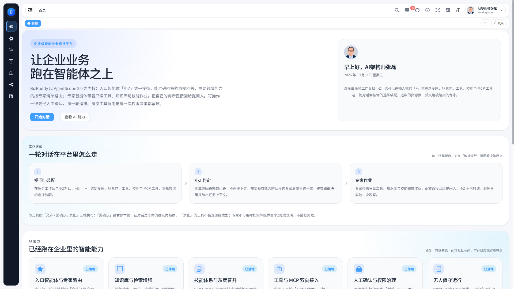

### 1.2 一轮对话怎么走

```
用户提问（任务工作台）
  │  ① 提问与装配：底栏「+」选定专家 / 场景包 / 工具 / 技能 / MCP 工具，本轮按选择装配
  ▼
入口智能体「小Z」
  │  ② 判定：能准确回答 → 自答；需要领域能力 → 调 route_decision 选一位专家 + 下发任务片段
  ├───────────────► 自答：直接输出回答，本轮结束
  ▼
领域专家
  │  ③ 作业：带只读工具 / 知识库 / 技能完成作业，正文直接交付用户（专家直答，小Z 不再转述）
  │  ④ 写工具命中「需确认」→ 本轮暂停、对话内弹确认卡片 → 用户处置后在同一轮继续
  ▼
回答交付 + 五类留痕（会话消息 / 工具调用 / 权限决策 / 链路追踪 / 编排运行）
```

关键设计取向：**能自己答就不路由**、**专家的正文不被二次改写**、**写操作一律受控**、**每一环都留痕**。

### 1.3 技术栈与运行依赖

| 分类 | 组件 | 版本 / 说明 |
|---|---|---|
| 语言 / 运行时 | Java | 21 |
| 框架 | Spring Boot | 4.1.1 |
| Web 容器 | Jetty（基于 Netty） | 随 Boot |
| **智能体内核** | **AgentScope Harness** | **2.0.3** |
| MCP 底座 | 官方 MCP Java SDK | 0.17.2 |
| 关系库 | PostgreSQL 14（默认）/ MySQL 8.0 | 库名均为 `biz_buddy` |
| 缓存 / 分布式状态 | Redis | ≥ 6.x |
| 向量库 | Milvus | v2.6.13（gRPC 19530） |
| 权限认证 | Sa-Token | 1.46.0 |
| ORM | MyBatis-Plus / MyBatis | 3.5.17 / 3.5.19 |
| 定时调度 | SnailJob | 2.0.2 |
| 工作流引擎 | Warm-Flow | 1.8.9 |
| 规则编排 | LiteFlow | 2.16.2.1 |
| 前端 | Vue 3.5 + TypeScript + Element Plus 2.14 + Vite 8 | 包管理 pnpm |

AI 能力全部落在后端模块 `ruoyi-ai`（包 `org.dromara.ai`），前端页面集中在 `plus-ui-Vue/src/views/ai/**`。

## 2. 功能地图与权限模型

### 2.1 菜单结构

一级菜单「BizBuddy」下设 **5 个分组**、**26 个功能页**（另有 74 个按钮权限）：

| 分组 | 功能页（路由） | 页面权限 |
|---|---|---|
| **智能体** | 任务工作台（`agent/chat`） | `ai:chat:send` |
| | 小Z配置（`agent/entry`） | `ai:agent:entry:query` |
| | 专家配置（`agent/expert`） | `ai:agent:list` |
| | 任务管理（`agent/session`） | `ai:session:list` |
| | 定时任务（`agent/task`） | `ai:task:list` |
| | 计划模式与任务清单（`agent/plan`） | `ai:runtime:plan` |
| | 技能仓库（`agent/skill`） | `ai:skill:list` |
| | 长期记忆（`agent/memory`） | `ai:memory:list` |
| | 工作区文件（`agent/workspace`） | `ai:workspace:list` |
| | 子智能体（`agent/subagent`） | `ai:subagent:list` |
| | 场景包（`agent/pack`） | `ai:pack:list` |
| **模型与推理** | 模型配置（`model/config`） | `ai:model:list` |
| | 用量与配额（`model/usage`） | `ai:usage:list` |
| | 上下文与压缩策略（`model/compaction`） | `ai:runtime:compaction` |
| **知识库** | 知识库管理（`kb/base`） | `ai:kb:list` |
| | 文档与切片（`kb/doc`） | `ai:kb:doc` |
| | 检索测试（`kb/retrieval`） | `ai:kb:retrieval` |
| **工具与集成** | 业务工具注册（`integration/registry`） | `ai:tool:list` |
| | MCP 服务端（`integration/mcp-server`） | `ai:mcp:server` |
| | MCP 客户端（`integration/mcp-client`） | `ai:mcp:client` |
| | 渠道接入（`integration/channel`） | `ai:channel:list` |
| **审计与观测** | 会话与消息审计（`audit/message`） | `ai:audit:message` |
| | 工具调用明细（`audit/toolCall`） | `ai:audit:toolcall` |
| | 权限决策日志（`audit/permission`） | `ai:perm:list` |
| | 链路追踪（`audit/trace`） | `ai:audit:trace` |
| | 编排运行（`audit/routeRun`） | `ai:audit:route` |

权限不足的菜单与按钮在前端自动隐藏；菜单仅对超级管理员自动可见，普通角色需在「系统管理 → 角色管理」勾选后可见。

### 2.2 权限标识约定

- 统一格式 `ai:{模块}:{动作}`，例：`ai:model:test`、`ai:tool:tag:add`、`ai:audit:route:query`。
- 动作语义：`list` 列表、`query` 详情、`add` 新增、`edit` 修改、`remove` 删除，另有 `test`（连通性 / 连接测试）、`copy`（模型复制）、`run`（立即执行）、`export`（导出）、`upload` / `parse` / `vector` / `preview`（文档处理）、`consolidate`（记忆合并）、`mode`（切换全局权限模式）等。
- 唯一**无权限校验**的端点是渠道回调 `/ai/channel/callback/**`（免登录，安全边界由平台验签 / 解密与渠道口令承担，同时在 `security.excludes` 与 `xss.excludeUrls` 中放行）。

### 2.3 工具三档授权

智能体绑定的每个业务工具都要配一档决策，落到 `ai_agent_tool.decision`：

| 档位 | 值 | 行为 |
|---|---|---|
| 允许 | `0` | 直接执行，不打扰用户 |
| 需确认 | `1` | 执行前暂停本轮，对话内弹确认卡片（HITL） |
| 禁止 | `2` | 不注册给模型，模型根本看不到该工具 |

「记住该工具」会把某用户对某工具的选择沉淀为**用户级信任**（`ai_agent_tool_trust`，维度：智能体 × 工具 × 用户），此后该用户不再被询问；可在专家配置页逐条撤销。

## 3. 智能体与对话

### 3.1 任务工作台（对话）

平台的主界面：左侧会话列表，右侧消息流，底部输入栏。

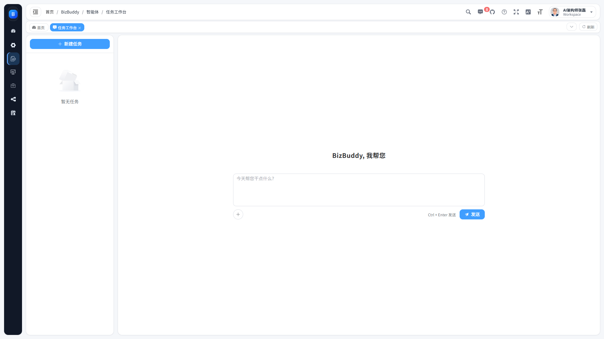

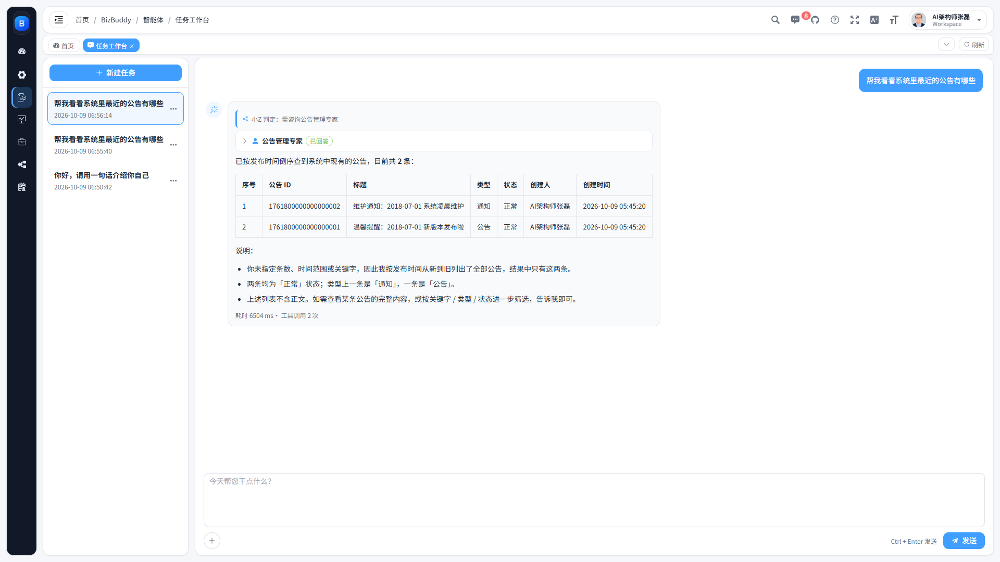

**会话列表**：新建任务、置顶、重命名、删除；会话标题与最后活跃时间倒序。

**消息流**：用户 / 助手 / 系统三类消息，助手消息支持：

- **Markdown 渲染**（含表格、代码块）；
- **工具调用卡片**：默认收起，仅显示工具名 / 来源标签 / 状态 / 耗时，点击卡片头部展开「调用入参」与「结果摘要」——**入口智能体自己调用工具**时逐条渲染；**委派给专家后**，专家侧的工具调用在主会话只以底部「· 工具调用 N 次」汇总，逐条明细见「工具调用明细」审计页；
- **专家卡片**：显示专家名称、状态、重试次数与失败原因，展开可见专家原始结论；
- **路由提示条**：如「小Z 判定：需咨询××专家」「小Z 判定：本轮由自己回答」「已指定专家：××专家」；
- **内联确认卡片**：需确认的写工具在此处处置——允许本次 / 记住该工具 / 拒绝，刷新后仍可还原；
- 用户消息悬停出现「发出时间 + 复制 + 删除」（删除按**整轮**语义：该提问 + 其对应回答）；**带附件时在气泡内一并渲染**（图片显示缩略图、文档显示文件名）。

**输入栏**：最左侧「+」为**资源选择器**，顶部第一项是「**上传附件**」（回形针图标），其下以**分割线**与资源分组隔开；资源分组按 **专家 / 场景 / 工具 / 技能 / MCP 工具** 排列（MCP 按 Server 二级展开），选中项以标签 chip 跟在后面，chip 悬停出现叉号可移除；右侧为发送 / 停止。

**附件（多模态对话）**：支持**图片**与**文档**——从「+」菜单选「上传附件」后，文件先上传为**暂存件**并以标签 chip 显示在底栏（可移除），**发送时才与消息绑定**。

- **图片**：单张 ≤ 512KB，装配期读回字节转 **Base64 data URI** 下发，**要求所选模型支持视觉**；
- **文档**：单文件 ≤ 5MB，由文档解析器抽为**纯文本内联**进本轮消息（超长保留首尾截断），**不落知识库、不做切片**（与知识库链路是两回事）；
- 单条消息最多 **5** 个附件；附件内容随任务片段**一并下发给专家**，故入口与专家看到的是同一份材料；
- 流式回答进行中不可上传；仅放行解析器支持的后缀，扫描件 / 纯图片 PDF 解析不出文本会被拒绝。

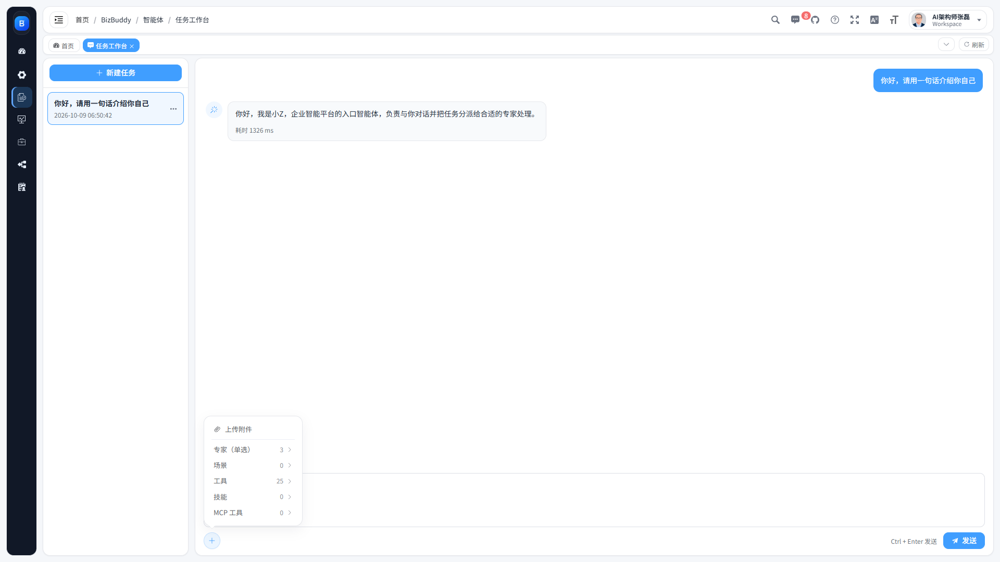

**对话链路（后端）**：发消息拆成两步——先 `POST /ai/chat/session/{id}/message` 落库拿到稳定 `messageId`，再 `GET /ai/chat/stream` 建立 SSE 取回答；被 HITL 暂停的一轮用 `GET /ai/chat/resume` 恢复。SSE 事件除正文外还含 `route_decision` / `expert_start` / `expert_result` / `tool_confirm` 等编排事件。

### 3.2 小Z配置（入口智能体）

小Z 是**全平台唯一的入口智能体**（`ai_entry_agent` 表由唯一索引强制单行），负责理解提问、决定自答还是路由给专家。

该页**只有一张表单、无列表、无绑定区**：

| 字段 | 说明 |
|---|---|
| 名称 / 编码 | 编码创建后不可修改（已作为 AgentScope 的 agent name 使用） |
| 描述 | 一句话说明小Z 职责 |
| 系统提示词 | 决定其判定与路由纪律 |
| 绑定模型 | 入口轮使用的对话模型 |
| 角色模型 | 压缩摘要 / 记忆抽取 / 子智能体三个模型槽位（可分别指定，留空回退主模型） |
| 配额 | 日 Token / 日请求 / 月 Token 三项上限 |
| 归属部门 / 可见范围 | 数据归属与可见性 |
| 最大迭代次数 / 状态 / 备注 | 单轮最大迭代、启停与备注 |

> 小Z 的可用工具、知识库、技能与 MCP **不在此处绑定**，而是来自**会话级资源集**（在任务工作台选择）；其唯一内置协议工具是 `route_decision`。

### 3.3 专家配置

维护可被路由的领域专家。

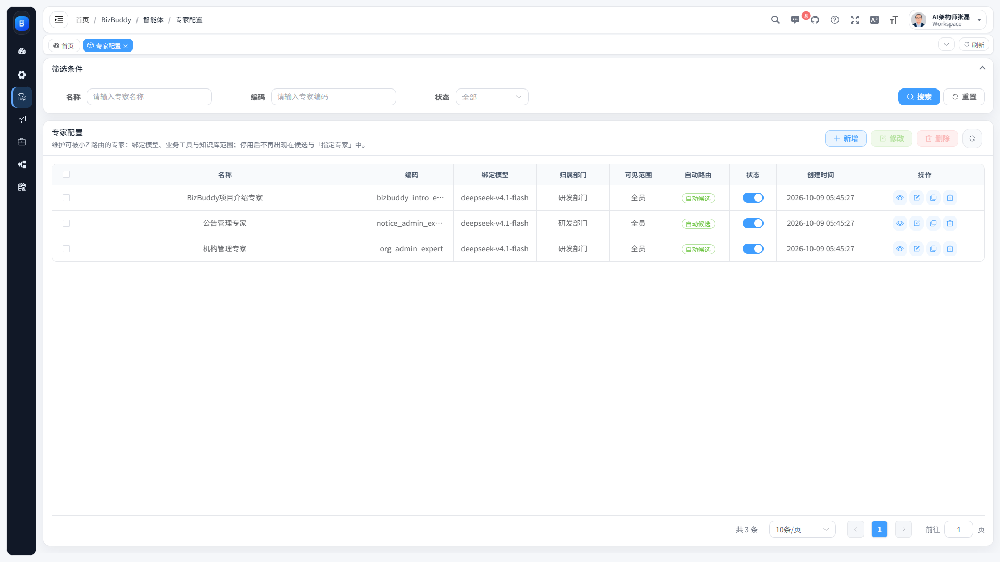

**列表**：名称 / 编码 / 绑定模型 / 归属部门 / 可见范围 / 自动路由 / 状态 / 创建时间 / 操作（查看、修改、复制、删除）。

**筛选项**：名称（模糊）、编码、状态。

**表单字段**：

| 字段 | 说明 |
|---|---|
| 名称 / 编码 | 编码创建后不可修改 |
| 描述 | 参与路由提示词（**自动候选清单里的「擅长」即取此字段**），务实地说明该专家擅长什么 |
| 系统提示词 | **只写领域知识与口径**（术语、业务规则、回答侧重）；行为纪律（专家直答、写操作必须真调用、DENIED 不重试、重复执行去重等）由平台在编排期**强制注入**，无需在此重复书写；留空回落平台默认提示词 |
| 绑定模型 | 专家轮使用的对话模型 |
| **自动路由** | `开启`＝进入小Z 自动候选清单；`关闭`＝不进自动候选，**只能被用户在会话中手动指定** |
| 工具集 + 工具授权 | 勾选业务工具，并为每个工具配「允许 / 需确认 / 禁止」三档 |
| 已记住的工具 | 仅编辑既有专家时显示：按**用户 × 工具**列出「记住该工具」沉淀的免确认决策（含 MCP 等未绑定工具），可逐条撤销 |
| 知识库 / 技能 / 子智能体 | 多选绑定（选项按当前用户可见性过滤） |
| 角色模型 | 压缩摘要 / 记忆抽取 / 子智能体三个模型槽位 |
| 配额 | 日 Token / 日请求 / 月 Token |
| 归属部门 / 可见范围 | 决定谁能看到并指定该专家 |
| 最大迭代次数 / 状态 / 备注 | 单轮最大迭代、启停与备注 |

**只读详情**：按主键重新拉取详情再弹窗，覆盖模型、配额、角色模型槽位、工具集与授权决策、知识库、技能、子智能体、备注与时间，系统提示词与参数定义单独成块。

**填写辅助（降低填写负担）**：

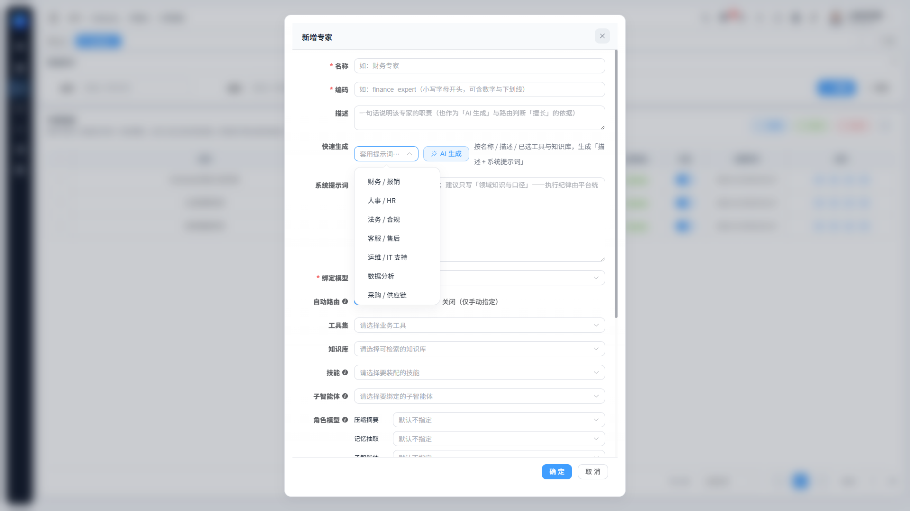

- **提示词 AI 辅助生成**：只需填少量硬信息（名称 / 一句话说明 / 已选工具 / 已选知识库 / 是否允许写操作），点「AI 生成」后由**一次模型调用**补全**描述 + 系统提示词**建议值，生成结果**可继续编辑**。所用模型取表单当前所选（未选则取平台首个启用对话模型），**需先在「模型配置」补齐该模型密钥**，否则会如实报错（不是缺陷）；
- **模板套用**：内置 **9 类**领域模板（财务 / 人事 / 法务 / 客服 / 运维 / 数据分析 / 采购 / 行政 / 知识问答），一键套用骨架（已含能力边界与拒答口径），套用前二次确认；
- **克隆专家**：列表操作列「复制」按既有专家**预填新增表单**——清空主键与编码、名称加「-副本」，其余字段（模型 / 工具 / 知识库 / 技能 / 子智能体 / 提示词 / 配额 / 角色模型槽位）原样带入；保存前**需自行填写新编码**（编码唯一）；
- **保存前体检**：提交时按规则给出**建议**（提示词长度、是否写明能力边界与拒答口径、知识库与写操作是否和实际绑定一致、描述是否缺失等），**只建议、不硬拦**，可选择「仍然保存」。

### 3.4 任务管理（会话）

跨用户的会话治理入口：分页检索会话（可按智能体筛选）、查看消息记录与工具调用明细、批量终止、批量删除（含消息并清理 Redis 记忆）、导出会话留档。权限 `ai:session:list` / `:query` / `:edit` / `:remove` / `:export`。

### 3.5 定时任务

让智能体按 Cron **无人值守**运行。

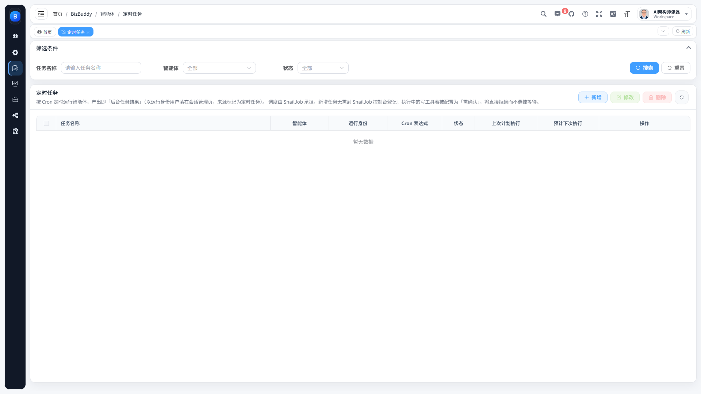

- 任务表单：任务名称、智能体、**运行身份用户**、Cron 表达式、任务提示词、状态、备注与配额；
- 操作：新增 / 修改 / 删除 / **立即执行一次**（不影响 Cron 排期）/ 查看只读详情；
- **执行记录**弹窗：状态、耗时、Token、工具次数，并可深链到该次运行的会话明细；
- 调度承载为 SnailJob（应用侧按各任务 Cron 判定到点，并以 `last_run_time` 原子抢占去重）。

> 无人值守场景下**写工具一律拒绝**：定时任务与渠道触发都不会自动写入，需要人确认的写操作必须在对话页完成。

### 3.6 计划模式与任务清单

- **计划模式**：开启后智能体先进入**只读设计阶段**，产出计划文件并**经人工确认后**才执行；
- **任务清单**：启用 `todo_write` 工具，让智能体在多步任务中维护可见的待办清单。

两项默认关闭，可在本页按需开启并调整相关参数。

### 3.7 技能仓库

技能的**唯一来源是平台数据库**（`ai_skill` 存 `SKILL.md` 正文 + `ai_skill_resource` 存参考资料），按「智能体 × 技能」绑定装配。

- 列表：技能名称 / 标识 / 使用计数 / 状态 / 更新时间等，支持查看只读详情（含参考资料）；
- 维护技能正文与参考资料、绑定给智能体；
- 技能标识创建后不可修改；
- 智能体侧由框架注册 `load_skill_through_path` / `read_skill` 两个内置工具按需加载技能内容；装配期会给专家提示词追加「技能优先」纪律。

### 3.8 长期记忆

按用户隔离的长期记忆（默认关闭）——开启后每轮对话自动抽取事实写入**每日流水**，并按节流策略**合并进记忆**。

- 配置：开关、注入上限 Token、合并可读 Token 上限、两次合并最小间隔、每日流水与会话日志保留天数、抽取触发策略（always / throttled / never）；
- 记忆文件清单与内容查看 / 编辑；
- **手动触发合并**（`POST /ai/memory/consolidate`）。

### 3.9 工作区文件

在线编辑智能体的**人格与行为约定**文件（`AGENTS.md`）及附加上下文文件，注入系统提示词。

- 配置卡：工作区上下文注入开关 + 附加上下文文件清单；
- 文件表：区分**共享默认** / **用户覆盖** / **当前生效**三层；
- 分层编辑器：保存、清除用户覆盖（回落共享默认，含二次确认）。

### 3.10 子智能体

维护可被主智能体**委派**的子智能体：用途说明、隔离 / 共享工作区、模型、步数上限、只读工具白名单，并绑定给智能体。子智能体是平台级可复用资产（`ai_subagent` + `ai_agent_subagent` 多对多绑定）。

### 3.11 场景包

按角色 / 部门把资源**打包**，对话时选用以快速增强能力。

- 场景包本体：编码（**创建后不可修改**）+ 名称 + 用途说明 + 生效范围（公开 / 本部门 / 仅本人）+ 状态 + 备注；
- 包内三类资源：**业务工具**（选中后逐工具配三档授权，包内决策优先）、**外部 MCP 工具**（按 Server 分组，仅列启用中连接的 `enable_tools` 白名单）、**技能**（仅列当前用户可见）；
- 列表以「业务工具 N / MCP 工具 N / 技能 N」标签概览包内能力；
- 只读详情展示三类绑定明细（带决策标签）。

## 4. 模型与推理

### 4.1 模型配置

统一维护模型提供商、密钥与参数，是智能体可选用模型的来源。

- 增删改查：模型标识、名称、提供商、接入地址（OpenAI 兼容）、密钥（**密文落库、不回显**，修改时留空保持原值）、参数、状态、备注；
- **连通性测试**：不必保存即可测试配置是否可用（`POST /ai/model/test`）；
- **复制**：整行复制既有业务列——密钥**密文原样搬运**（复制 ≠ 重新授权）、状态原样复制，名称自动唯一化（`原名 + copy`，重名继续追加）；
- 删除时若被智能体引用则拦截。

### 4.2 用量与配额

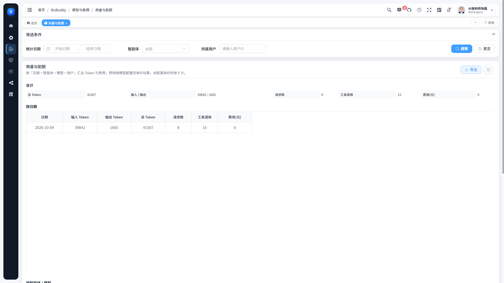

- 用量明细与总览：按**日期 / 智能体 / 模型**多维聚合 Token 用量与费用；
- 配额：在智能体（含小Z与专家）上配置日 Token / 日请求 / 月 Token 上限；
- 支持导出用量明细。

### 4.3 上下文与压缩策略

避免超长对话超出模型上下文窗口：

- 触发阈值：消息条数阈值、Token 数阈值；
- 压缩后保留的尾部消息条数；
- 压缩前是否将完整历史**落盘留痕**、是否**卸载为工作区 jsonl 文件**；
- **大工具结果卸载**：超过阈值字符数的工具结果落盘，仅回填首尾预览。

## 5. 知识库与检索

专家作业时的 RAG 增强，向量存储在 Milvus，检索一律按**提问用户的生效范围**过滤。

### 5.1 知识库管理

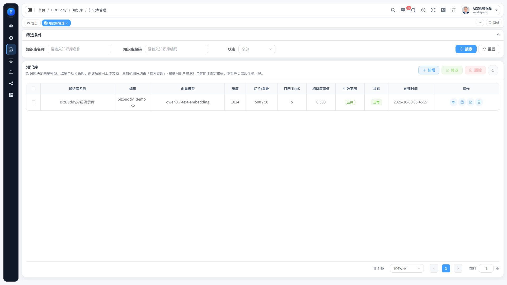

建库并设定：知识库名称 / 编码、向量模型、向量维度、切分策略（分段大小 / 重叠）、生效范围、状态与备注；支持只读详情。

### 5.2 文档与切片

- 上传文档（文件入对象存储后登记）；
- **解析**：重建文档切片（`POST /ai/kb/doc/{id}/parse`）；
- **向量化**：重建向量索引（`.../vectorize`）；
- **切片分页查看**、**解析后纯文本在线预览**；
- 删除文档（连带切片与向量）。

### 5.3 检索测试

召回效果调试：输入查询语句，调整 **Top-K** 与**相似度阈值**，实时查看命中片段与相似度分数，用于确定入库策略与阈值。

## 6. 工具与集成

### 6.1 业务工具注册

平台可被智能体调用的**语义化工具**登记处。工具由代码侧实现（`AiToolFactory` 按 `impl_name` 映射到 `AgentTool` 实例），注册页只登记元数据——**不产生任何可执行能力，因此不会出现裸 SQL / 裸 Shell / 裸 HTTP 工具**。

| 字段 | 说明 |
|---|---|
| 工具编码 / 名称 | 唯一标识与中文名 |
| 工具类型 | `只读` / `写入`（写入类需配「需确认」） |
| 实现标识 | 代码侧实现键（`impl_name`） |
| 参数定义 | JSON Schema（下发给模型的入参说明） |
| 状态 | 停用后不再装配进智能体 |
| MCP 暴露 | 是否允许对外暴露给 MCP 出口（仅只读工具可勾选） |
| 说明 / 备注 | 用途说明 |

**标签**：工具栏「标签管理」可维护标签（名称唯一、含使用工具数），删除标签会**级联解除**与全部工具的关联；列表支持按标签筛选与「仅看未打标签」。

### 6.2 MCP 服务端（对外出口）

把平台的只读工具**对外提供**给第三方 AI。

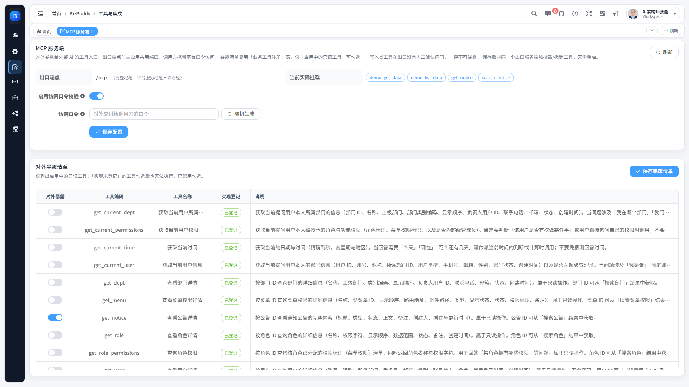

- 出口端点 `/mcp`，可配置**访问口令**与启用状态；
- 维护**暴露工具清单**（仅只读工具可勾选，保存后**热生效**）；
- 开启口令校验时，外部调用方必须携带口令（`Authorization: Bearer <token>` 或 `X-MCP-Token`），未配置口令则拒绝所有请求。

### 6.3 MCP 客户端（接入外部）

配置**外部 MCP Server**，把第三方系统能力接入平台供智能体使用。

- 连接配置：Server 名称、传输方式、Server 地址、**工具白名单**、请求头（密文落库，不回显）、请求与初始化超时、用途说明、状态；
- **测试连接**：连通并列出该 Server 的可用工具，便于筛选白名单；
- 白名单决定子智能体/场景包/工作台可见的 MCP 工具范围。

### 6.4 渠道接入

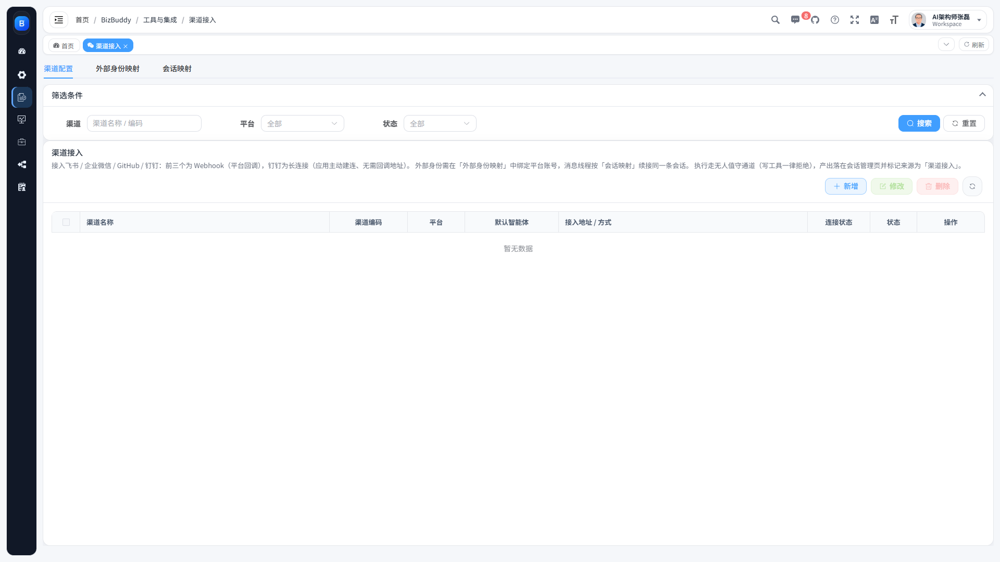

接入**飞书 / 企业微信 / 钉钉 / GitHub**，让外部平台用户免登录与智能体对话。页面为三页签：

1. **渠道配置**：字段随平台类型动态切换；凭据留空保持原值；展示回调地址与长连接提示；钉钉显示连接状态（新增即建连、修改重连、删除断连）。
2. **外部身份映射**：外部平台的用户标识 → 平台账号（用平台用户选择器）。
3. **会话映射**：外部消息线程 → 平台会话，可跳转会话明细。

**回调与安全**：回调地址为 `/ai/channel/callback/{platform}/{channelCode}`，在 `security.excludes` 与 `xss.excludeUrls` 中放行；各平台分别做签名校验 / 解密（飞书含 URL 校验握手与事件幂等、企业微信含 GET 握手与 XML 密文解密、GitHub 校验签名并按 comment.id 幂等、防机器人自评与自环限流）。**渠道触发一律拒绝写工具**。

## 7. 审计与观测

平台对对话链路做**五类留痕**，各页之间可相互深链排障。

### 7.1 会话与消息审计

跨会话检索消息明细（按关键词、智能体、用户、时间范围），支持导出留档。

### 7.2 工具调用明细

- 明细表：工具名、**发起智能体**（按明细行自身的 `agent_id` 归属，专家执行的调用显示为专家而非会话智能体）、触发用户、会话、状态、耗时、入参 / 出参；
- **按工具统计**：次数 / 成功 / 失败 / 失败率 / 平均耗时；
- 筛选：关键词、工具名、状态、发起智能体（含已停用）、会话 ID、触发用户、时间范围。

### 7.3 权限决策日志

`ALLOW / ASK / DENY` 全量留痕：工具授权决策与人工确认的处置结果，用于回答「这次为什么被拦下 / 被询问」。

### 7.4 链路追踪

一次任务一条记录：执行期**模型版本**（含槽位回退说明）、**上下文清单**、**状态迁移时间线**；列表含来源 / 状态 / 模型 / 耗时 / Token。

### 7.5 编排运行

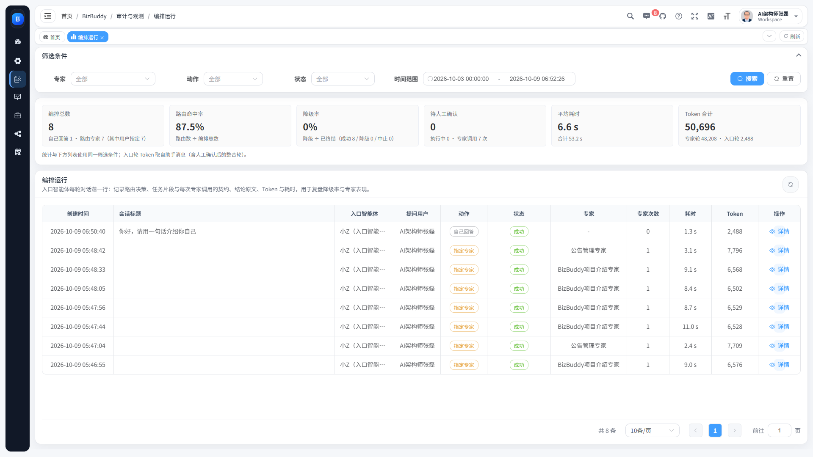

入口智能体**每一轮编排一行**，是路由质量与降级情况的主观测页。

- 筛选：专家（含已停用）、动作（自己回答 / 路由专家）、状态（执行中 / 待人工确认 / 成功 / 降级 / 中止）、时间范围（默认近 7 天，可清空看全量）；
- **统计卡**：编排总数与动作分布、**路由命中率**、**降级率**（不含未终结）、待人工确认与专家调用次数、平均与合计耗时、Token 合计（专家轮 · 入口轮分列）；
- 列表：创建时间、会话标题、入口智能体、提问用户、动作、状态（降级原因 tooltip）、参与专家、专家次数、耗时、Token；
- **详情抽屉**：路由决策（动作 / 目标专家 / 理由 + **决策原文**）、下发给专家的**任务片段**、专家调用明细（行展开看**专家输出原文留证**，状态含「已回答 / 未完成 / 调用失败 / 超时 / 待人工确认」）；
- 支持 `?sessionId=` 深链，从任务工作台直接跳到某一轮。

## 8. 配置项与运行依赖

### 8.1 运行依赖

| 组件 | 说明 |
|---|---|
| 关系库（二选一） | PostgreSQL 14：库 `biz_buddy`，导入 `script/sql/postgres/` 下四个脚本；MySQL 8.0：库 `biz_buddy`，导入 `script/sql/` 下四个脚本（含 `ry_ai.sql`）。技能仓库按数据源类型自动装配，无需改配置 |
| Redis ≥ 6 | 缓存、分布式锁、AgentScope 分布式状态 |
| Milvus v2.6.13 | 知识库向量存储与检索（gRPC `19530`） |
| SnailJob | 定时任务调度承载（`ruoyi-extend/ruoyi-snailjob-server`，未启动只影响定时触发） |

### 8.2 AI 平台配置（前缀 `bizbuddy.ai`）

绑定类 `AiProperties`，常用项：

| 配置 | 默认 | 说明 |
|---|---|---|
| `crypto-key` | `bizbuddy-ai-2026` | 模型密钥加密用的 AES 秘钥（生产必须替换） |
| `test-timeout-seconds` | 30 | 连通性测试默认超时 |
| `embedding-batch-size` / `embedding-max-chars` | 10 / 8000 | 向量化批大小与单条最大字符数 |
| `retrieval-score-threshold` | 0.3 | 向量检索默认相似度阈值 |
| `milvus.uri` | `http://127.0.0.1:19530` | Milvus 地址（另有用户名 / 密码 / 超时） |
| `chat.workspace-root` | `./data/agent-workspace` | 智能体工作区根目录 |
| `chat.default-max-iters` | 10 | 单轮默认最大迭代次数 |
| `chat.expert-timeout-seconds` | 180 | 单次专家调用同步等待上限 |
| `chat.route-budget-expert-tokens` / `route-budget-seconds` | 60000 / 180 | 单轮编排的专家轮 Token 预算与墙钟预算（0＝不限） |
| `chat.expert-write-dedup-enabled` / `...-ttl-seconds` | true / 1800 | 专家写工具短期去重开关与有效期 |
| `chat.permission-mode` | `DEFAULT` | 全局工具权限模式（`DEFAULT` / `ACCEPT_EDITS` / `EXPLORE` / `BYPASS` / `DONT_ASK`） |
| `chat.pending-confirm-ttl-minutes` | 30 | 待确认工具调用的有效期 |
| `chat.image-max-bytes` / `chat.document-max-bytes` | 524288 / 5242880 | 聊天上传**图片 / 文档**的单文件大小上限（512KB / 5MB） |
| `chat.document-inline-max-chars` / `chat.max-attachments-per-message` | 20000 / 5 | 文档内联进本轮消息的最大字符数、单条消息可带附件数上限 |
| `chat.compaction-enabled` 等 | true / 50 / 80000 / 20 | 上下文压缩开关、触发消息数 / Token 数、保留尾部条数 |
| `chat.tool-result-eviction-enabled` 等 | true / 80000 / 2000 | 大工具结果卸载开关、阈值与预览字符数 |
| `chat.plan-mode-enabled` / `task-list-enabled` | false | 计划模式与任务清单开关 |
| `chat.memory-enabled` 等 | false / 8000 / 4000 / 30 | 长期记忆开关、注入上限、合并上限、最小间隔 |
| `chat.workspace-enabled` | true | 工作区上下文注入开关（与记忆解耦） |
| `chat.mcp-server-auth-enabled` / `mcp-server-token` | true / 空 | MCP 出口口令校验与口令 |
| `chat.current-time-enabled` / `current-time-zone` | true / `Asia/Shanghai` | 每轮注入当前时间及其时区 |