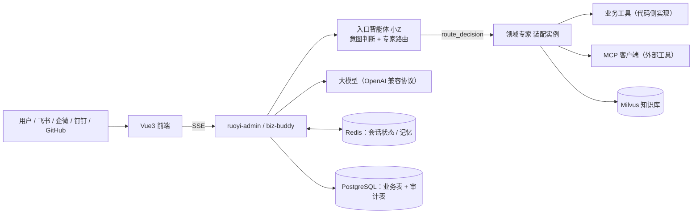

# 架构总览

面向开发者的运行时架构说明。**只讲"东西是怎么跑起来的"**，便于二次开发时判断改动该落在哪一层。

## 1. 整体形态

BizBuddy 是一个**企业级智能业务运行平台**：在成熟中后台底座之上叠加一套可运营的 AI 能力。

| 层 | 组件 | 说明 |
|---|---|---|
| 前端 | `plus-ui-Vue` | Vue 3 + TypeScript + Element Plus，流式对话走 SSE |
| 后端 | `RuoYi-Vue-Plus` | Spring Boot 4.1.1 + JDK 21，多模块 Maven |
| 业务底座 | RuoYi-Vue-Plus 6.0.0 | RBAC、工作流、调度、代码生成、OSS、统一消息推送 |
| 智能体内核 | **AgentScope Harness 2.0.4** | 工具循环、中间件、权限三态、HITL、状态存储、上下文压缩、技能 |
| 数据 | PostgreSQL 14 / Redis / Milvus | 业务与审计 / 会话状态与锁 / 向量检索 |

**一个进程、一个 jar**：AI 能力是后端的一个模块（`ruoyi-modules/biz-buddy`），不是独立服务。



## 2. 核心运行链路：入口智能体 → 专家

所有对话**先进入口智能体「小Z」**（`entry_agent`）。小Z 不绑业务工具，它有一个协议工具：

| 工具 | 作用 |
|---|---|
| `route_decision` | 把任务交给专家（`action=route` / `expert_agent_key` / `task_context`），或声明自己回答（`action=self`） |

- 小Z 先判断自己能否准确回答；不能、或专家更专业，才 `route`；
- **专家直答**：被选中的专家回复**直接交付用户**，小Z 不再输出正文（避免二次改写与信息损耗）；
- 专家调用失败 / 超时 / 无产出 → 降级为小Z 兜底自答，并如实说明未拿到专家结论。

`route_decision` 会在**同一轮 ReAct 循环内就地完成整条专家编排**（调用 → 落库 → 下发事件），把结果作为工具结果回喂小Z，因此不需要额外的编排驱动。

两点补充：

- **用户消息可以是多模态的**：一轮消息除文本外还可携带**附件**（图片 / 文档，先上传为暂存件、发送时绑定消息）。图片在装配期读回字节转 **Base64 data URI** 经 `ImageBlock` 下发（需视觉模型；2026-10-10 起**上传时**按 `ai_model_config.supports_vision` 对「入口智能体 + 本会话指定专家」做前置校验，未声明支持即拒绝并给出提示）；文档解析为**纯文本内联**（不切片、不向量化）。两者的内容块**随任务片段一并下发给专家**，故专家与入口看到的是同一份材料；附件内容**不落知识库、不进记忆抽取**。
- **指定专家＝固化路由**：会话上存在 `pinned_expert_id` 时，编排**忽略模型给出的 `action`、强制交给该专家**（落 `action=pinned`），服务端保证「用户指定了就一定由它答」；路由失败 / 契约不合格时**不换专家**，就地重试或降级如实说明。

## 3. 装配：智能体 × 会话资源集

智能体实例由 `AgentRegistry` 装配并缓存，缓存键是 **`智能体 × 会话资源集签名`**：

```
小Z   ： agentId # R:<sig>
专家  ： agentId # __expert__ # R:<sig>
```

- `<sig>` 是会话资源集（选的场景包 / 工具 / 技能 / MCP 工具）压成的确定性签名；
- 资源**内容**变更（工具停用、决策改动、提示词改动等）由装配**指纹**触发重建；
- 因此「改选择后下一轮生效」，且同一资源组合的多个会话**共享**实例。

装配时确定的事（运行期无法绕过）：注册哪些工具、写入哪些权限规则、注入哪些中间件与运行期策略。

### 会话资源集（重要）

**小Z 的工具来自会话级资源集**，不是平台全局配置：对话底栏 `+` 里选中的工具 / 技能 / MCP 工具，在**下一轮**生效，且**每个会话各自一份**。

> 常见误区：在「MCP 客户端」页配好连接 ≠ 小Z 就能用。前者只是让工具**可被选中**，还需在会话里选中它。

## 4. 权限：三层模型

| 层 | 时机 | 机制 |
|---|---|---|
| ① 工具可见面 | 装配期 | 智能体绑定 ∪ 会话资源集 ∪ 平台内置只读；`禁止`档的工具**不注册**（模型不可见） |
| ② 三档授权 | 运行期 | `ai_agent_tool.decision`：`0` 允许 / `1` 需确认（HITL）/ `2` 禁止；来源优先级：会话直接选中 > 场景包 > 智能体绑定 |
| ③ 业务权限复核 | 执行期 | 工具内用 `PermissionService` 按提问用户复核菜单权限，纵深防御 |

要点：

- **写操作默认「需确认」**，命中即由框架原生 HITL **暂停**并下发确认卡片，用户确认后用 `ConfirmResult` 恢复执行；
- **平台内置无害只读工具**（`get_current_time` / `get_current_user` / `get_current_dept` / `get_current_permissions`）无需绑定即注册并默认放行；
- 用户级「记住该工具」信任按 `(userId, sessionId)` 槽位在每轮并入，**不写进共享实例**；
- 工具运行在 **Reactor 线程**：Sa-Token 线程上下文不可用，操作人要从 `RuntimeContext` 取，权限校验用不依赖线程上下文的 `PermissionService`。

## 5. 工具与 MCP

**业务工具是「元数据 + 代码实现」两段式**：

- `ai_tool` 表只存元数据（编码、名称、描述、参数 Schema、类型、实现标识、启停、是否对外暴露）；
- 真正的能力必须在代码侧登记于 `AiToolFactory`（`implName → AgentTool`），**注册页本身不产生任何可执行能力**。

这样设计是为了避免出现「裸 SQL / 裸 Shell / 裸 HTTP」的万能工具。新增工具见 [development.md](development.md)。

**MCP 双向**：

- 出口：自建 `/mcp`，把标记为「对外暴露」的**只读**工具提供给外部调用方，带访问口令校验；
- 接入：作为 MCP 客户端连接外部 Server。远端工具名可能不满足 LLM 的 function name 规范（如 `weather.search_local`），装配期会做**工具名归一化**，否则严格模型会整轮 400。
- 回参守卫：外部 MCP 工具的回参在客户端层逐块脱敏（`GuardingMcpClientWrapper` 包在装配期最外层），第三方返回里的 PII 不直进模型。

## 6. 状态、记忆与审计

- **会话状态**：AgentScope `AgentStateStore`，本项目接 Redis（`RedisAgentStateStore`，键前缀 `bizbuddy:ai:agentscope`）。多轮记忆、HITL 暂停/恢复都依赖它；
- **工作区**：每个智能体一个工作目录，承载 `AGENTS.md`（人格与行为约定）与长期记忆文件；
- **链路追踪与审计**（PostgreSQL）：

| 表 | 记录 |
|---|---|
| `ai_trace` | 每次执行的装配快照（模型、工具清单、策略）与状态迁移 |
| `ai_route_run` / `ai_route_expert_call` | 小Z 的路由决策、每次专家调用 |
| `ai_tool_call_log` | 工具名、入参、出参、状态、耗时、归属智能体 |
| `ai_permission_decision_log` | 每次权限决策与人工确认 |
| `ai_daily_digest` | 平台运行日报落库（每天一条：五块快照 + 日报正文 + 溯源 id），由写工具 `write_daily_digest` 按 `digest_date` upsert |

## 7. 定时与多渠道

- **定时任务**：AI 任务由 SnailJob 调度（`ruoyi-extend/ruoyi-snailjob-server` + `ruoyi-job`）——任务只按 cron 调用智能体并记执行记录（`ai_agent_task_run`），**不承载场景化投递**（场景产出由智能体自己用工具完成）。无人值守链路**没有人类可确认**：命中「需确认」档的写工具被改写为**拒绝**（不暂停、不悬挂），只有**显式配为「允许」**的写工具才会执行——典型例子是**平台运行日报**：专家 `platform_ops` 调 `write_daily_digest` 把五块结果 upsert 进 `ai_daily_digest`（落库属于「记录」，不是状态变更）；
- **渠道入站**：**Webhook 平台**（飞书 / 企业微信 / GitHub）由外部平台回调驱动，安全边界由平台验签 / 解密与渠道口令承担（见 `application.yml` 的 `security.excludes`）；**长连接**渠道（钉钉、飞书 `mode=ws`）由应用主动外连、**免公网 IP 与回调地址**——生命周期统一由 `AiChannelRuntimeRegistry` 承载（应用就绪后拉起、配置变更**先停后建**、关闭时全停），入站报文经各平台 mapper 归一化后走**同一条**无人值守链路（钉钉零依赖自实现，飞书用官方 Larksuite OAPI SDK 薄封装）。**入站多媒体**：图片转图片内容块、可解析文档（PDF / docx / xlsx / pptx / 文本类）抽取后内联、语音 / 视频仅用平台转写；钉钉群聊图片下发为 `richText`，由运行时补归一化，媒体下载失败 / 不支持的类型降级为标记文本。渠道管理面另提供「按手机号查外部用户标识」辅助接口（`GET /ai/channel/{id}/external-user-id`，仅钉钉 / 飞书；由无状态客户端 `AiChannelUserLookupClient` 用渠道已存凭据调平台通讯录接口）。

## 8. 相关文档

- [README.md](README.md) —— 开发者文档索引与代码导览
- [development.md](development.md) —— 加一个业务工具（最常见的扩展）
- [configuration.md](configuration.md) —— 配置项参考
- [../deploy/deploy-pg/README.md](../deploy/deploy-pg/README.md) / [../deploy/deploy-mysql/README.md](../deploy/deploy-mysql/README.md) —— 两套容器编排（PostgreSQL 14 / MySQL 8.0，端口错开可并存）
- [../e2e/](../e2e) —— 端到端脚本（在真实栈上验证上述链路：模型连通、知识库检索、专家编排、HITL 闭环）